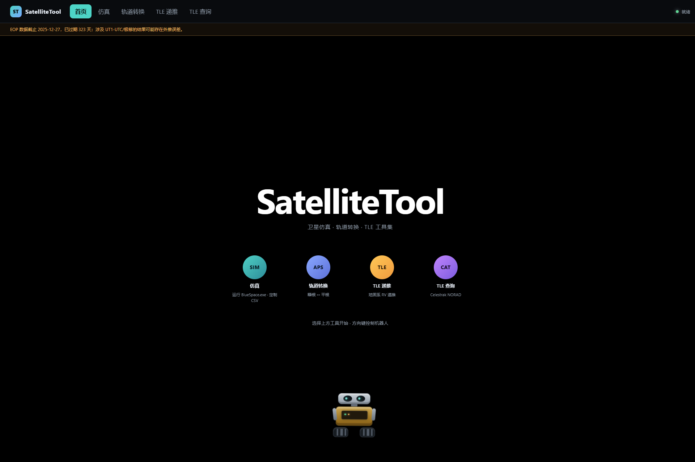
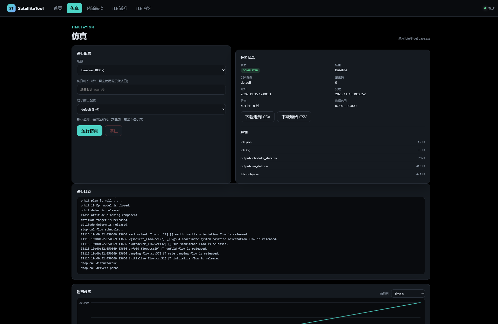
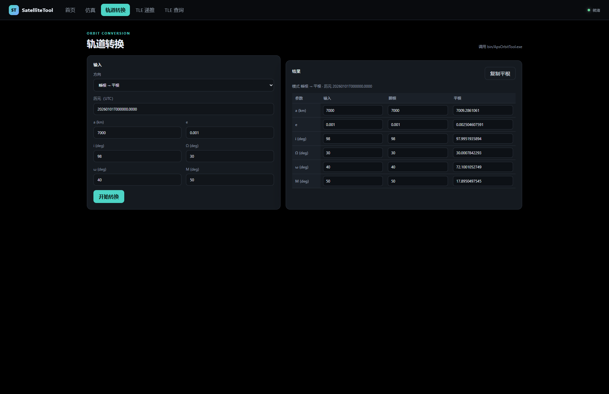
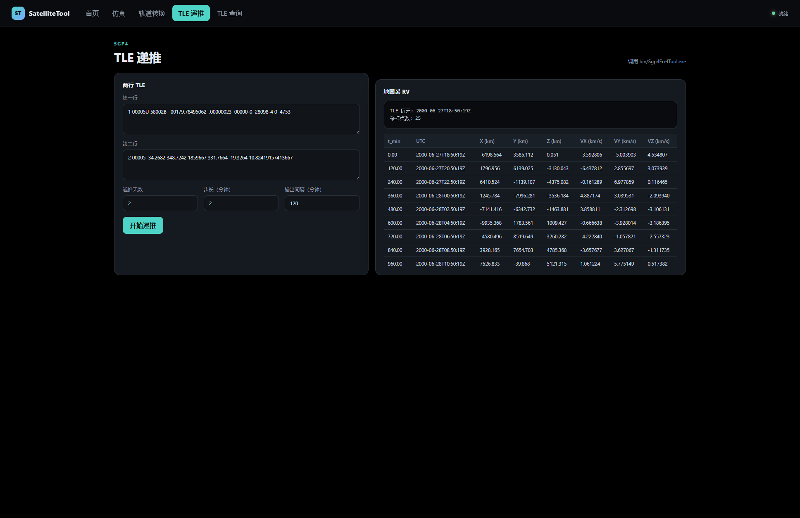
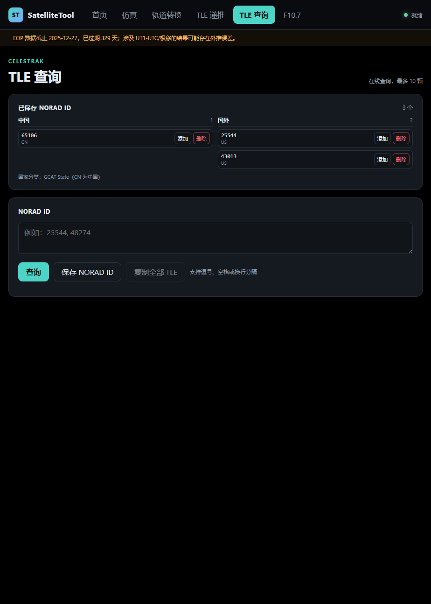
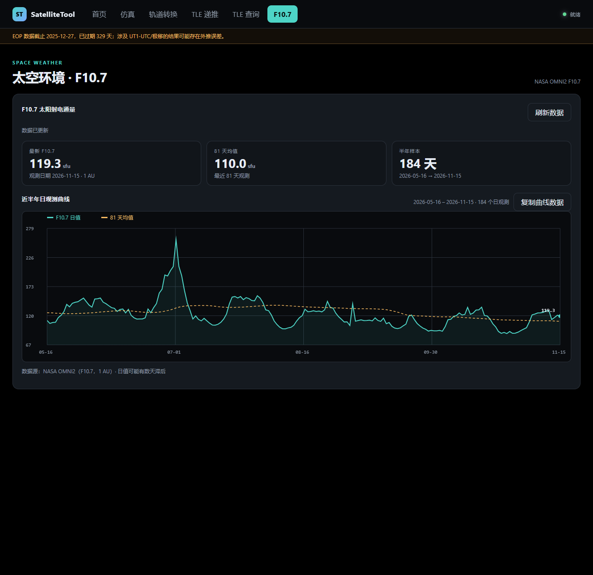

# SatelliteTool

SatelliteTool is a Windows-local satellite workbench that wraps compiled
BlueSpace executables with a small Python web UI. It provides simulation,
APS orbit conversion, SGP4 TLE propagation, and Celestrak TLE lookup.

[中文](README.md) · [Contributing](CONTRIBUTING.md) · [Security](SECURITY.md) ·
[Changelog](CHANGELOG.md)

## Quick start

Requirements: Windows 10/11 x64, Python 3.9+, and the executables in `bin/`.

```powershell
cd SatelliteTool
python app.py --open
```

Default URL: <http://127.0.0.1:8765/>.

The runtime uses only the Python standard library. Node.js, Ruff, and Black are
optional development tools; Ruff/Black currently require Python 3.10+.

## Screenshots

| Home | Simulation |
| --- | --- |
|  |  |

| APS | TLE propagation | TLE lookup |
| --- | --- | --- |
|  |  |  |

| F10.7 space weather |
| --- |
|  |

## Features

- Solid-black home page with five shortcuts and a WALL-E-style robot that wraps
  across all four edges and can be steered with the arrow keys;
- Simulation with configurable duration and CSV telemetry profiles;
- APS osculating/mean element conversion with copy-mean support;
- SGP4 TLE-to-ECEF propagation;
- Celestrak lookup for up to 10 NORAD IDs with per-row/all copy, plus a local
  saved-ID list with add/delete actions and GCAT-based China/foreign grouping;
- NASA OMNI2 F10.7 page with latest daily value, 81-day mean, six-month chart,
  and curve CSV copy;
- Job history, log tail, output downloads, and history cleanup;
- Local-only defaults, Host/Origin checks, CSP, and configurable resource limits.

## Security

The server binds to `127.0.0.1` by default and has no authentication. Do not
expose it to the public internet. Non-loopback binding requires the explicit
`--allow-remote` flag. See [SECURITY.md](SECURITY.md).

## Development

```powershell
python -m pip install -r requirements-dev.txt
python -m unittest discover -v
python -m ruff check .
python -m black --check .
node --check static/app.js
```

## License and data

The project is licensed under Apache-2.0. Bundled binaries come from the
BlueSpace project; third-party notices are in [NOTICE](NOTICE) and
[third_party/README.md](third_party/README.md). Data versions and update notes
are in [docs/DATA.md](docs/DATA.md).

The EOP dataset currently ends at 2025-12-27; the UI shows a stale-data warning
for later scenarios.
