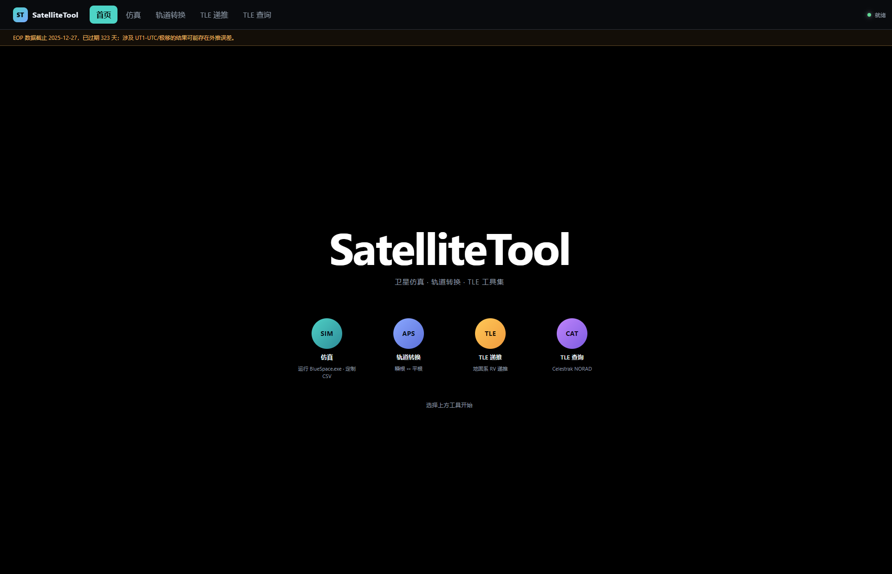
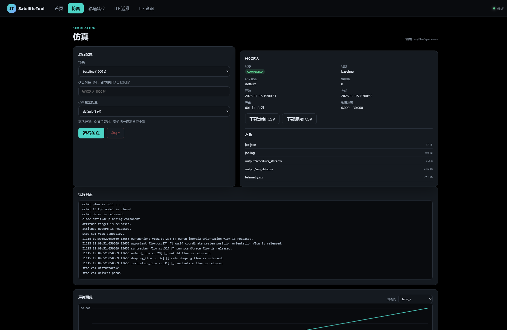
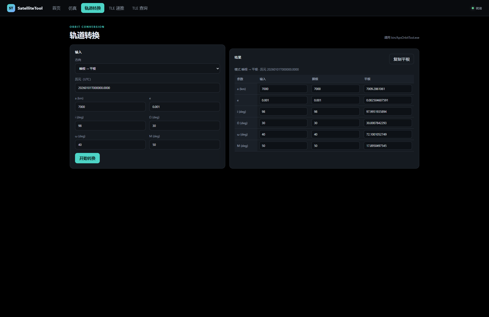
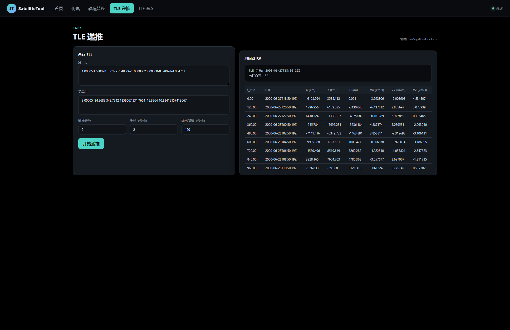

# SatelliteTool

SatelliteTool 是一个面向 Windows 的本地卫星仿真工具工作台，把 BlueSpace
仿真、APS 轨道转换和 SGP4 TLE 递推集中到一个浏览器界面中。计算通过
`bin/` 中的**已编译 exe** 完成，本仓库**不包含 C++ 实现源码**。

[English](README.en.md) · [贡献指南](CONTRIBUTING.md) · [安全策略](SECURITY.md) ·
[更新日志](CHANGELOG.md) · [文档](docs/)

## 1. 快速开始

要求：

- Windows 10/11 x64；
- Python 3.9+；
- `bin/` 中存在三个 exe 和依赖 DLL。

```powershell
cd SatelliteTool
python app.py --open
```

也可以双击 `start.bat`。默认地址：<http://127.0.0.1:8765/>。

首次启动前确认：

```text
bin/BlueSpace.exe
bin/ApsOrbitTool.exe
bin/Sgp4EcefTool.exe
bin/*.dll
```

exe 不在默认位置时，修改 `config/tool.json` 的 `executables`。
Python 依赖只有标准库；Node.js 仅用于可选的 `node --check static/app.js`。

## 截图

| 首页 | 仿真 |
| --- | --- |
|  |  |

| 轨道转换 | TLE 递推 | TLE 查询 |
| --- | --- | --- |
|  |  |  |

## 2. 功能

- **首页**：纯黑背景和四个快捷入口；
- **仿真**：选择场景、仿真时长和 CSV 配置，运行 `BlueSpace.exe`；
  预览表显示前 20 行，曲线对完整数据流式降采样；
- **轨道转换**：调用 `ApsOrbitTool.exe`，结果按输入表单展示，支持一键复制平根；
- **TLE 递推**：调用 `Sgp4EcefTool.exe`，输出地固系位置/速度；
- **TLE 查询**：Celestrak 查询最多 10 个 NORAD ID，结果按行展示，支持单行/全部复制；
- **CSV 定制**：按 JSON 配置选择列、重命名、缩放、偏移和精度；
- **历史任务**：日志、原始 CSV、定制 CSV、调度统计；支持清理历史；
- **安全/资源边界**：本机监听、Host/Origin 校验、统一错误、仿真/SGP4/预览上限。

## 3. 目录结构

```text
SatelliteTool/
├── app.py                     # Python 标准库 HTTP 服务与作业管理
├── start.bat                  # Windows 启动脚本
├── config/
│   ├── tool.json              # exe 路径、运行目录、限制、历史策略
│   └── telemetry/             # CSV 输出配置
├── bin/                       # BlueSpace/APS/SGP4 exe、DLL、SHA256SUMS
├── runtime/
│   ├── cfg/                   # BlueSpace 分层配置
│   ├── data/                  # EOP、重力场、磁场等数据
│   └── modules/log/conf/       # glog 配置
├── static/                    # 前端页面、样式、脚本、favicon
├── runs/                      # 运行历史（git 忽略）
├── docs/                      # 架构、API、集成、数据、排错
├── test_app.py                # 单元测试
├── pyproject.toml             # Ruff/Black 配置
├── requirements-dev.txt       # 开发工具
├── LICENSE
├── NOTICE
└── README.md
```

`runtime/` 是 BlueSpace 的运行资产，不是 C++ 源码。升级 BlueSpace 时同步新的
`cfg/`、`data/`、`log/conf/` 和 exe/DLL 即可。

## 4. 配置

### 4.1 `config/tool.json`

```json
{
  "name": "SatelliteTool",
  "version": "0.2.0",
  "server": { "host": "127.0.0.1", "port": 8765 },
  "executables": {
    "simulation": "bin/BlueSpace.exe",
    "aps": "bin/ApsOrbitTool.exe",
    "sgp4": "bin/Sgp4EcefTool.exe"
  },
  "runtime": {
    "working_directory": "runtime",
    "config_root": "cfg",
    "data_root": "data",
    "log_config_dir": "modules/log/conf",
    "default_scenario": "baseline",
    "default_csv_profile": "default"
  },
  "telemetry": { "profiles_dir": "config/telemetry" },
  "limits": {
    "max_simulation_time_s": 1000000,
    "max_sgp4_samples": 20000,
    "preview_scan_rows_running": 200000,
    "preview_scan_rows_finished": 2000000
  },
  "history": { "keep_jobs": 50 }
}
```

相对路径相对于 `SatelliteTool/` 解析。

### 4.2 CSV 输出配置

在 `config/telemetry/` 新建 JSON：

```json
{
  "name": "my_profile",
  "description": "我的遥测列",
  "delimiter": ",",
  "columns": [
    { "name": "time_s", "source": "time_s", "precision": 3 },
    { "name": "roll", "source": "roll_deg", "precision": 6 },
    { "name": "roll_scaled", "source": "roll_deg", "scale": 0.1, "offset": 0.0, "precision": 6 },
    { "name": "task_flow", "source": "task_flow" }
  ]
}
```

| 字段 | 必填 | 说明 |
| --- | --- | --- |
| `name` | 是 | 输出 CSV 列名，不能重复 |
| `source` | 是 | 原始 `sim_data.csv` 列名 |
| `scale` | 否 | 数值乘数，默认 1 |
| `offset` | 否 | 数值偏移，默认 0 |
| `precision` | 否 | 小数位数 0–15；不填则保留原始字符串 |
| `delimiter` | 否 | 逗号/分号/制表符/竖线之一 |

配置在仿真结束后应用；原始 `sim_data.csv` 保留。源字段不存在时任务失败并提示。

## 5. 页面使用

### 仿真

1. 选择场景；
2. 可选填写仿真时长（秒）；留空使用场景默认值；
3. 选择 CSV 输出配置；
4. 点击“运行仿真”，查看日志、遥测预览和曲线；
5. 完成后下载 `telemetry.csv` 或 `output/sim_data.csv`。

运行中任务只扫描前若干行以降低开销，完成后按完整文件重新预览。历史任务可
在页面底部查看，支持“清理历史”。

### 轨道转换

输入方向、UTC 历元、`a/e/i/Ω/ω/M`，调用 `ApsOrbitTool.exe`。结果以只读表单
展示输入、瞬根和平根，并可一键复制平根六项参数。

### TLE 递推

输入两行 TLE、递推天数、步长和输出间隔，调用 `Sgp4EcefTool.exe`。采样点数量
受 `limits.max_sgp4_samples` 限制。

### TLE 查询

输入 1–10 个 NORAD ID（逗号、空格或换行分隔）。结果按行展示名称、NORAD、
入轨日期、TLE 历元与两行 TLE；每行可单独复制，也可复制全部成功结果。
离线时按 ID 返回错误，不影响其他卫星。

## 6. HTTP API

| 方法 | 路径 | 说明 |
| --- | --- | --- |
| GET | `/api/health` | 健康检查 |
| GET | `/api/info` | 版本、exe 状态、场景、CSV 配置、限制、EOP |
| GET | `/api/scenarios` | 场景列表 |
| GET | `/api/profiles` | CSV 配置列表 |
| GET | `/api/jobs` | 历史任务 |
| GET | `/api/jobs/<id>?limit=N` | 任务详情与 CSV 预览 |
| GET | `/api/jobs/<id>/log?tail=N` | 日志尾部 |
| GET | `/api/jobs/<id>/file?name=...` | 下载产物 |
| POST | `/api/run` | `{scenario, simulation_time?, csv_profile}` |
| POST | `/api/jobs/<id>/stop` | 停止当前任务 |
| DELETE | `/api/jobs/<id>` | 删除任务 |
| DELETE | `/api/jobs` | 清理所有非运行中任务 |
| POST | `/api/aps` | APS 转换 |
| POST | `/api/sgp4` | SGP4 递推 |
| POST | `/api/celestrak` | TLE 查询 |

详细请求/响应见 [docs/API.md](docs/API.md)。所有 POST 必须使用
`Content-Type: application/json`。

## 7. 安全与资源限制

- 默认只监听 `127.0.0.1`，没有登录鉴权，不要直接暴露公网；
- 校验 `Host`、`Origin`、`Sec-Fetch-Site`，POST/DELETE 拒绝跨站请求；
- 响应包含 CSP、`X-Frame-Options`、`X-Content-Type-Options` 等安全头；
- 非本机监听必须显式 `--allow-remote`，且当前版本仍无鉴权；
- 只能运行 `config/tool.json` 中配置的 exe；
- 场景名、NORAD ID、CSV 配置名、任务 ID 和下载路径均做白名单/越界校验；
- 同一时间只允许一个仿真任务；停止使用 Windows `taskkill /T /F`；
- 仿真时长、SGP4 采样点、CSV 预览扫描行数和历史保留数量均可配置；
- 下载采用流式输出，日志只读尾部。

安全问题请阅读 [SECURITY.md](SECURITY.md)，不要公开提交漏洞细节。

## 8. 开发与测试

```powershell
python -m pip install -r requirements-dev.txt
python -m py_compile app.py test_app.py
python -m unittest discover -v
python -m ruff check .
python -m black --check .
node --check static/app.js
```

当前测试 17 项，覆盖 CSV 导出、预览降采样、路径校验、配置校验、APS/SGP4 参数、
Host/Origin、Content-Type 和任务清理。

`app.py` 运行时只使用 Python 标准库，支持 Python 3.9+。Ruff/Black 开发工具
当前要求 Python 3.10+；CI 在 Python 3.12 上执行 lint，在 3.9–3.13 上执行测试。
Node.js 仅用于前端语法检查。

## 9. 数据与许可

本项目采用 **Apache License 2.0**，见 [LICENSE](LICENSE)。

- `bin/` 中的二进制来自 BlueSpace 项目（Apache-2.0），来源和 SHA256 见
  [bin/README.md](bin/README.md)；
- 第三方组件、SGP4 署名和数据来源见 [NOTICE](NOTICE)、
  [third_party/README.md](third_party/README.md)；
- EGM2008、IGRF、EOP、Celestrak 的版本和更新方式见 [docs/DATA.md](docs/DATA.md)；
- 首页已改为纯黑背景，仓库不再包含背景图片；
- 维护者当前主要面向研究与教学用途，第三方数据/二进制遵循原始许可。

> EOP 数据当前截止 2025-12-27；运行 2026 年及之后场景时，页面顶部会显示过期提示。

## 10. 贡献、支持与文档

- [CONTRIBUTING.md](CONTRIBUTING.md)
- [SECURITY.md](SECURITY.md)
- [CODE_OF_CONDUCT.md](CODE_OF_CONDUCT.md)
- [SUPPORT.md](SUPPORT.md)
- [ROADMAP.md](ROADMAP.md)
- [CHANGELOG.md](CHANGELOG.md)
- [docs/ARCHITECTURE.md](docs/ARCHITECTURE.md)
- [docs/API.md](docs/API.md)
- [docs/INTEGRATION.md](docs/INTEGRATION.md)
- [docs/TROUBLESHOOTING.md](docs/TROUBLESHOOTING.md)
- [docs/DATA.md](docs/DATA.md)
